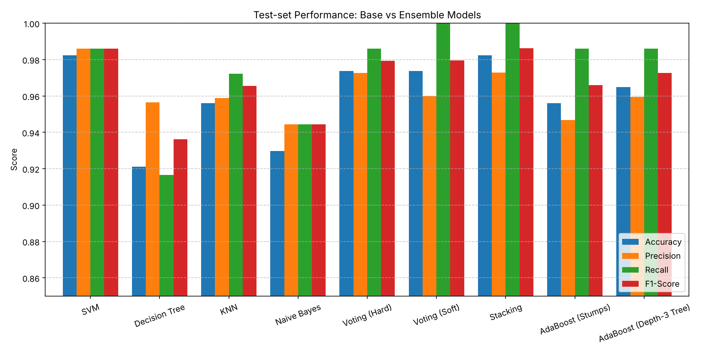

# Practical 5 – Ensemble Learning: Stacking, AdaBoost and Voting

**Student:** Ritesh Gavhane | **PRN:** 202401100082 | **Division:** B | **Batch:** AIML-4 | **Roll No.:** 29
**Course:** TY B.Tech. – Artificial Intelligence and Machine Learning

## Aim
1. Implement a **stacking** ensemble with a meta-classifier combining base classifiers.
2. Implement an **AdaBoost** ensemble with chosen base classifiers.
3. Implement a **voting** ensemble (majority / hard voting, plus soft voting for comparison).
4. Compare the ensembles with the base models using classification metrics.
5. Summarise findings, when to use each method, and directions for further improvement.

## Dataset
Breast Cancer Wisconsin (Diagnostic) – `sklearn.datasets.load_breast_cancer`: 569 samples, 30 numeric features,
binary target (0 = malignant, 1 = benign). Bundled with scikit-learn (no external file needed).
Split: 80% train (455) / 20% test (114), stratified, `random_state=42`. Scaling (`StandardScaler`) is applied
inside pipelines for SVM, KNN and Naïve Bayes, so it is fitted only on training data.

## Models
| Type | Model | Configuration |
|---|---|---|
| Base | SVM | RBF kernel, C = 1.0, probability = True |
| Base | Decision Tree | max_depth = 5 |
| Base | KNN | K = 5 |
| Base | Gaussian Naïve Bayes | default |
| Ensemble | Voting (Hard) | majority vote of the 4 base models |
| Ensemble | Voting (Soft) | average of predicted probabilities (extra comparison) |
| Ensemble | Stacking | 4 base models + Logistic Regression meta-classifier, cv = 5 |
| Ensemble | AdaBoost (Stumps) | depth-1 decision trees, 100 rounds, learning rate 0.5 |
| Ensemble | AdaBoost (Depth-3 Tree) | depth-3 decision trees, 100 rounds, learning rate 0.5 |

## Results (test set of 114 samples; 5-fold CV on all 569 samples)
| Model | Accuracy | Precision | Recall | F1 | ROC-AUC | Log Loss | CV Accuracy (mean ± std) |
|---|---|---|---|---|---|---|---|
| SVM | 0.9825 | 0.9861 | 0.9861 | 0.9861 | 0.9950 | 0.0860 | 0.9772 ± 0.0163 |
| Decision Tree | 0.9211 | 0.9565 | 0.9167 | 0.9362 | 0.9163 | 1.9708 | 0.9280 ± 0.0230 |
| KNN | 0.9561 | 0.9589 | 0.9722 | 0.9655 | 0.9788 | 0.4073 | 0.9631 ± 0.0179 |
| Naïve Bayes | 0.9298 | 0.9444 | 0.9444 | 0.9444 | 0.9868 | 0.4370 | 0.9297 ± 0.0199 |
| Voting (Hard) | 0.9737 | 0.9726 | 0.9861 | 0.9793 | – | – | 0.9561 ± 0.0124 |
| Voting (Soft) | 0.9737 | 0.9600 | 1.0000 | 0.9796 | 0.9868 | 0.1133 | 0.9543 ± 0.0150 |
| Stacking | 0.9825 | 0.9730 | 1.0000 | 0.9863 | 0.9904 | 0.0969 | 0.9684 ± 0.0143 |
| AdaBoost (Stumps) | 0.9561 | 0.9467 | 0.9861 | 0.9660 | 0.9835 | 0.3829 | 0.9613 ± 0.0181 |
| AdaBoost (Depth-3 Tree) | 0.9649 | 0.9595 | 0.9861 | 0.9726 | 0.9911 | 0.2594 | 0.9701 ± 0.0131 |

Ensembles clearly improve on the weaker base models (Decision Tree, Naïve Bayes), but the SVM is already very strong
and is matched, not beaten, by Stacking. With only 114 test samples, one prediction changes accuracy by about 0.9
percentage points, and the CV standard deviations (~0.012–0.023) are larger than most gaps between the top models.



## Repository contents
| File | Description |
|---|---|
| `ensemble_models.py` | Complete implementation (run this) |
| `ensemble_models_comparison.ipynb` | Same code as a Jupyter notebook, with outputs |
| `requirements.txt` | Python dependencies |
| `sample_output.txt` | Console output of the script |
| `results.csv` | Full metrics table |
| `metrics_comparison.png` | Test-set metrics bar chart |
| `cv_accuracy.png` | 5-fold CV accuracy with standard deviation |
| `adaboost_staged.png` | AdaBoost test accuracy vs number of boosting rounds |

## How to run
```bash
pip install -r requirements.txt
python ensemble_models.py     # prints metrics, writes results.csv and the PNG plots
# or open ensemble_models_comparison.ipynb in Jupyter / Google Colab and run all cells
```
